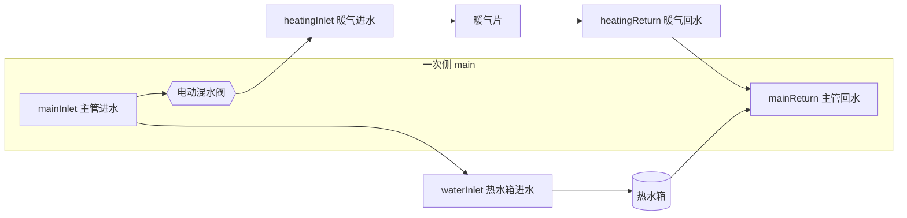
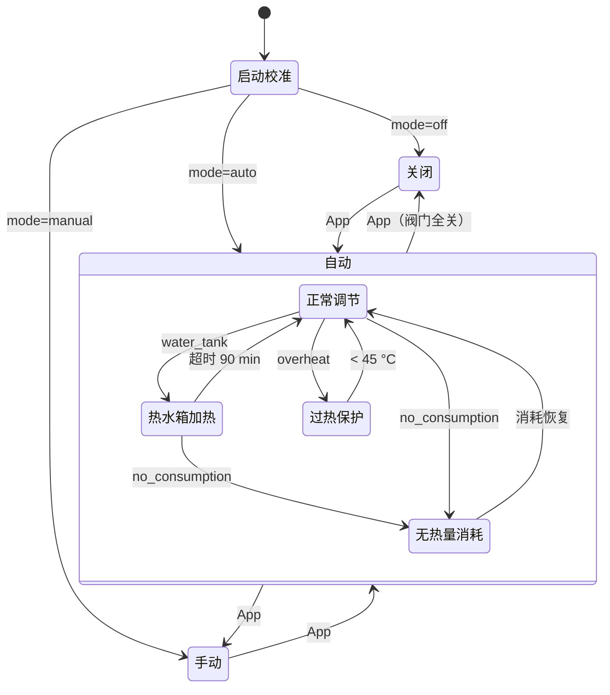

# HCP 架构与控制逻辑（v2）

本文描述控制器的模块、线程模型、阀门模型、控制算法、特殊工况和故障处理，以及相对 v1（旧版 `hcpmain.py`）修复了哪些问题、改变了哪些行为。快速上手看 [README](../README.md)，接口看 [API.md](API.md)，重新搭建硬件看 [REBUILD.md](REBUILD.md)。旧版的图表说明保留在 [v1-overview.html](v1-overview.html)。

## 1. 系统背景

控制目标：**让主管回水 `mainReturn` 保持在 `[目标温度, 目标温度 + 10]`**，同时防止暖气回路过热，并在热水箱加热、无热量消耗时做相应处理。

## 2. 模块

| 模块 | 职责 |
|---|---|
| [hcp/\_\_main\_\_.py](../hcp/__main__.py) | 入口：读配置、组装组件、日志、信号处理（SIGTERM/SIGINT → 关闭继电器后退出） |
| [hcp/config.py](../hcp/config.py) | 全部可调参数及默认值；`config.json` 覆盖；拼写错误的键直接报错 |
| [hcp/sensors.py](../hcp/sensors.py) | DS18B20 读取线程；单个传感器故障不影响其他；CRC 有限次重试；过滤 85 °C 上电值和不合理读数；超过 60 秒未更新视为无读数 |
| [hcp/relay.py](../hcp/relay.py) | I²C 继电器板驱动（写重试、两路互锁）；`FakeRelay` 用于模拟和测试 |
| [hcp/valve.py](../hcp/valve.py) | 开环阀门：位置计数、限位、校准（顶到底清零）、`finally` 中保证继电器断电 |
| [hcp/monitor.py](../hcp/monitor.py) | 特殊工况检测（纯逻辑，带锁存和回差） |
| [hcp/controller.py](../hcp/controller.py) | 唯一的控制线程：模式、自动控制规则、工况处理、手动指令、状态快照 |
| [hcp/state_store.py](../hcp/state_store.py) | `data/state.json`（模式、目标温度、阀门位置），原子写入；首次启动迁移 v1 的 `settings/*.txt` |
| [hcp/history.py](../hcp/history.py) | 每日 CSV、内存历史（给 App 画曲线，启动时从 CSV 回填）、事件日志 |
| [hcp/api.py](../hcp/api.py) | 标准库 `ThreadingHTTPServer` 实现的 JSON API |
| [hcp/simulator.py](../hcp/simulator.py) | 简单的热力模型，`--simulate` 时代替传感器 |
| [hcp/mqtt.py](../hcp/mqtt.py) | 可选 MQTT 发布（默认关闭） |

运行时只依赖 Python 3 标准库和 `python3-smbus`（apt）。

## 3. 线程模型

| 线程 | 周期 | 做什么 |
|---|---|---|
| `sensors` | 10 s | 读 5 个传感器，生成快照；回调写 CSV、内存历史、日志、MQTT |
| `controller` | 0.5 s tick | **唯一**驱动阀门的线程：处理挂起的指令、每 15 s 运行一次工况检测、自动控制 |
| `http` | 按请求 | 读状态快照；指令只在锁内修改「期望状态」（模式、目标、手动目标、校准请求），由控制线程执行 |
| 主线程 | — | 等待退出信号，然后依次停止 API、控制器（继电器断电）、传感器 |

v1 中事件处理函数在监控线程里直接动阀门，并通过全局变量和主循环交互；v2 把所有决策和动作收敛到一个线程，消除了这些竞态。

## 4. 阀门模型

阀门没有位置反馈。位置以「步」计数：一步 = 继电器通电 0.5 秒，**0 = 完全关闭**，最大 `full_stroke_pulses = 120`（60 秒全行程，来自 v1 的 `turndown.sh`）。v1 的计数以 -25 为全关，v2 的所有位置 = v1 值 + 25：

| 名称 | v2 | v1 | 用途 |
|---|---|---|---|
| 全关 | 0 | -25 | 关闭模式、校准 |
| `reduced_position` | 25 | 0 | 过热 / 无热量消耗时关到这里 |
| `ready_position` | 34 | 9 | 自动模式开始时先开到这里 |
| `auto_min` | 35 | 10 | 自动控制不会关得比这更小 |
| `auto_max` | 66 | 41 | 自动控制不会开得比这更大 |
| 全开 | 120 | — | 手动模式可到达 |

**校准**（`close_fully`）：向关闭方向驱动「当前位置 + 20 步」（位置不可信时驱动 140 步），顶到机械限位后计数清零。以下情况会校准：启动时（`calibrate_on_startup`）、切到关闭模式、App 里手动校准、继电器故障恢复后。

**互锁**：通电前先把另一路写 0；换向前暂停 0.5 秒；任何异常或退出信号都会在 `finally` 中把两路继电器写 0。

## 5. 自动控制

每 15 秒做一次判断。规则按顺序计算，**后面的覆盖前面的**（所以关小优先于开大），与 v1 完全一致。设 `T` = 目标温度：

| 顺序 | 条件 | 动作 | rule |
|---|---|---|---|
| 1 | 暖气进水 < 30 | 开大 | `heating_inlet_low` |
| 2 | 暖气进水 + 主管回水 < 70 | 开大 | `sum_low` |
| 3 | 主管回水 < T | 开大 | `below_target` |
| 4 | 暖气进水 + 主管回水 ≥ 95 | 关小 | `sum_high` |
| 5 | 主管回水 > T + 10 | 关小 | `above_target` |
| — | 都不满足 | 保持 | `in_range` |

- 开大：若位置 < `ready_position` 先开到它；然后若 < `auto_max` 开 1 步，之后额外等待 60 秒
- 关小：若 > `auto_min` 关 1 步，之后额外等待 30 秒
- 修改目标温度后立即重新判断

必需传感器（主管进水、主管回水、暖气进水）任一无读数时进入 `sensor_fault`：**阀门保持不动**，直到读数恢复。

## 6. 特殊工况

工况检测每 15 秒用最新一次传感器读数运行一次（同一读数不会重复计入）。「持续上升」= 最近 5 个样本严格递增；样本缺失会打断上升序列。

| 工况 | 进入条件 | 退出条件 | 自动模式下的动作 |
|---|---|---|---|
| 过热 `overheat` | 暖气进水 > 65 且持续上升 | 暖气进水 < 45 | 关到 `reduced_position`，自动控制暂停。**手动模式下同样生效**，且不允许开大 |
| 无热量消耗 `no_consumption` | 主管回水 > 65 且 进水−回水 < 3 | 主管回水 < 60 或 进水−回水 > 5 | 关到 `reduced_position`，自动控制暂停 |
| 热水箱加热 `water_tank` | 进水−回水 > 10 且 主管进水 > 70 且 热水箱进水 > 60 且持续上升 | 进入过热或无消耗，或超过 90 分钟 | 阀门保持不动，自动控制暂停 |
| 暖气偏热（瞬时） | 暖气进水 > 55 且持续上升，且未过热 | — | 正常调节时关小 1 步 |

优先级：继电器故障 > 关闭 > 过热 > 手动 > 传感器故障 > 无消耗 > 热水箱 > 正常调节。

## 7. 持久化与故障处理

| 情况 | 处理 |
|---|---|
| 断电 / 进程被杀 | 状态文件原子写入（临时文件 + fsync + rename），不会写坏；启动时先把两路继电器写 0，再校准阀门 |
| `state.json` 损坏 | 记录错误，用默认值（自动、默认目标温度）启动，阀门标记为未校准并在启动时校准 |
| 某个传感器坏了 / 拔掉 | 该传感器显示「无读数」，其他照常；必需传感器缺失时自动控制保持阀门不动；App 里显示提醒 |
| CRC 错误 | 最多重试 3 次，然后本轮放弃（v1 会无限重试卡死） |
| I²C 写失败 | 每次写重试 3 次；仍失败则进入 `relay_fault`，阀门标记未校准，60 秒后尝试校准恢复 |
| 控制线程异常 | 记录异常，5 秒后继续，不会静默退出 |
| 进程崩溃 | systemd `Restart=always`，10 秒后重启 |
| 配置错误 | 启动时校验（键名、类型、位置大小关系），错误直接退出并打印原因 |

## 8. 相对 v1 修复的问题

| v1 问题 | v2 |
|---|---|
| `target_temperature.txt` 为空时 `None` 比较抛 `TypeError`，主线程退出 | 目标温度持久化在 `state.json`，缺失或越界时用默认值 / 夹到范围内；API 拒绝非法值 |
| `settings.py` 异常分支引用不存在的 `self.file_path` | 模块已重写 |
| 传感器 ID 缺失 `KeyError`、CRC 无限重试、读不到值时格式化崩溃、读取线程静默退出 | 见上表，逐个传感器容错 |
| 进程退出时继电器可能保持通电 | `finally` + 信号处理 + 启动时先断电 |
| 热水箱模式可能永远不退出 | 90 分钟超时 |
| 手动脚本绕过计数导致位置漂移；「设成 102 再关到 0」的计数与实际不符 | 计数以全关为 0，所有手动操作走 API；校准真正顶到底再清零 |
| `no_concumption` 不锁存，每 15 秒重复关阀并和主循环来回拉扯 | 所有工况锁存 + 回差 |
| 工况检测每 15 秒取一次、传感器每 10 秒更新，同一读数会被重复计入，导致「持续上升」判断失真 | 只有新读数才进入趋势窗口 |
| 全局变量跨线程读写、`inEventHandling` 竞态 | 单控制线程 |
| `logs/` 需手动创建；相对路径要求在项目目录启动；导入时就打开 SMBus | 目录自动创建；路径基于安装目录；SMBus 延迟打开，可在 Mac 上模拟运行和测试 |
| MQTT 未接入且不兼容 paho 2.x | 可选接入，兼容 1.x/2.x，后台自动重连 |
| WinSCP 脚本 `-hostkey=*`、路径写死 | Mac / Windows 都用系统自带 ssh/scp，校验主机指纹 |

## 9. 行为上的变化

- 启动时默认先校准（阀门全关约 1 分钟，再开到起始开度）。可用 `valve.calibrate_on_startup: false` 关闭。
- 无热量消耗现在会锁存：阀门关到低开度后保持，直到主管回水 < 60 °C 或温差 > 5 °C。v1 是关一下、下一轮又可能被主循环开大。
- 热水箱加热最长暂停 90 分钟。
- 过热保护在手动模式下也生效。
- 启动/停用不再通过 `settings/heating_active.txt`，改为 App 或 API 中的「关闭 / 自动 / 手动」。首次启动会从旧文件迁移一次。
